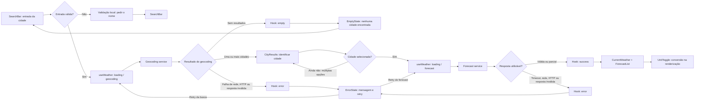

# Plano Técnico — Weather App

Fonte da verdade: [especificação de produto](../specs/weather-app-spec.md). A spec está marcada como rascunho; este plano define contratos e decisões técnicas propostas, mas não aprova suas perguntas em aberto. Antes de congelar tarefas, resolver os bloqueios indicados em **Open Questions** e atualizar contratos afetados.

## Architecture

Aplicação web client-side, sem backend próprio na primeira entrega. O navegador coordena a busca, consulta a Open-Meteo por HTTPS, normaliza suas respostas e renderiza a interface. Isso evita adicionar servidor, autenticação ou persistência, conforme D-04; depende de validar CORS, termos, atribuição e limites do provedor em OQ-11.

Camadas e responsabilidades:

- `components`: formulário de busca, seleção de resultados, clima atual, previsão diária, seletor de unidade e estados de UI. Componentes exibem dados e emitem ações; não chamam a API diretamente.
- `hooks`: orquestração do fluxo de busca e consulta, seleção da cidade, repetição e proteção contra respostas obsoletas.
- `services`: integração HTTP com a Open-Meteo, classificação de falhas e validação/normalização da resposta externa.
- `lib`: conversão de temperatura, formatação pt-BR, datas/fuso e mapeamento de códigos meteorológicos.
- `types`: contratos de domínio e estados compartilhados.

Respostas externas são dados não confiáveis: validar formato e valores, renderizar textos como texto e não incorporar segredos ao bundle. Não usar localização do dispositivo sem aprovação.

**Decisão pendente:** AC-01 determina seguir automaticamente quando houver uma única cidade; A-02 diz que essa correspondência “pode” abrir diretamente. Manter a decisão provisória identificada e resolver OQ-04/OQ-08 antes do aceite final.

## Tech Stack

Reutilizar a stack existente, sem dependências adicionais sem necessidade:

- TypeScript strict e React 19 para interface e contratos.
- Vite para desenvolvimento e build client-side.
- Tailwind CSS para estilos, seguindo as convenções do projeto.
- pnpm para dependências e scripts.
- Vitest e Testing Library para testes unitários/de componentes; Playwright para E2E.
- Biome para lint e formatação.
- Fetch API nativa e `AbortController` para HTTP e cancelamento.

Antes de publicar, verificar termos da Open-Meteo, atribuição obrigatória, CORS e limites de uso. Se chamadas do navegador forem incompatíveis, reabrir a decisão arquitetural; não introduzir proxy por antecipação.

## Project Structure

Preservar a organização estabelecida pelo repositório:

- `src/components/`: busca, seleção de cidades, clima atual, previsão, seletor de unidade e componentes de estados; um componente por arquivo.
- `src/hooks/`: hook de orquestração da busca, seleção, consulta, retry e estados.
- `src/services/`: geocoding, forecast, validação e normalização de respostas.
- `src/lib/`: funções puras de conversão, datas/fuso, formatação e descrição dos códigos meteorológicos.
- `src/types/`: tipos de cidade, clima, previsão, unidade, estado e erro.
- `src/styles/`: estilos globais e configuração visual existente.
- `tests/unit/`: testes de funções, serviços, hooks/estados e componentes.
- `tests/e2e/`: fluxos críticos com respostas de rede controladas.

Manter o entrypoint e a configuração Vite existentes. Não criar backend, persistência de servidor, diretórios ou camadas genéricas sem requisito aprovado.

## Data Model

Contratos de domínio propostos. Valores indisponíveis são `null`, nunca substituídos por zero. Os campos atuais e diários definidos em D-06/D-07 são o escopo mínimo; indicadores adicionais dependem de OQ-02.

| Contrato | Campos e semântica |
| --- | --- |
| `Unit` | `celsius` ou `fahrenheit`; inicial em Celsius. Persistência da preferência depende de OQ-06. |
| `City` | `id?`, `name`, `admin1?`, `country?`, `countryCode?`, `latitude`, `longitude`. Nome e coordenadas são obrigatórios para consultar clima; dados administrativos podem estar ausentes; nome isolado não é chave. |
| `CurrentWeather` | `temperatureC: number | null`, `weatherCode: number | null`, `observedAt: string | null`, `humidityPercent: number | null`, `windSpeedKmh: number | null`, `precipitationMm: number | null`, `pressureHPa: number | null`. Métricas ausentes permanecem nulas. `observedAt` vem de `current.time`; timezone não pertence a este contrato. |
| `ForecastDay` | `date: YYYY-MM-DD`, `temperatureMinC: number | null`, `temperatureMaxC: number | null`, `weatherCode: number | null`, `precipitationProbabilityPercent: number | null`. Um item por dia da janela; dados ausentes permanecem nulos. |
| `WeatherData` | `city`, `current: CurrentWeather | null`, `forecast: ForecastDay[]`, `timezone: string`, `source: "Open-Meteo"`, `fetchedAt: ISO timestamp`. `timezone` vem da resposta raiz e é obrigatório para interpretar datas locais; `fetchedAt` não substitui `observedAt`. |
| `WeatherError` | `kind`: `network`, `timeout`, `rateLimit`, `http` ou `invalidResponse`; mensagem localizada separada do detalhe técnico. Geocoding vazio não é erro. |
| `WeatherState` | União discriminada com estados explícitos `idle`, `loading`, `success`, `empty`, `error` e `selectingCity`. `loading` carrega `stage: geocoding | forecast`; os demais estados carregam apenas query, resultados, cidade, dados ou operação com falha que sejam aplicáveis. |

Normalizar as respostas para Celsius e preservar sua precisão interna; arredondar apenas na exibição. A regra proposta é arredondamento para o inteiro mais próximo, empates afastados de zero e normalização de zero negativo (A-06/OQ-06). Validar coordenadas finitas e dentro dos limites geográficos, temperaturas finitas, datas válidas e códigos meteorológicos conhecidos ou indisponíveis.

## Data Flow

1. Usuário digita e confirma a cidade. Rejeitar entrada vazia localmente, preservar os caracteres e codificar o texto na URL; tolerância a erros de digitação depende de OQ-04.
2. O hook inicia uma busca identificada e chama geocoding. Nova busca invalida ou cancela a operação anterior.
3. Uma lista vazia válida resulta em `empty`; resposta inválida, HTTP ou rede resulta em `error`; uma correspondência segue a regra provisória de AC-01; várias levam a `selectingCity`.
4. Ao selecionar uma cidade, o hook entra em `loading` com `stage: forecast` e consulta pela identidade geográfica escolhida.
5. O serviço consulta a API, valida e normaliza os dados. Alinha as previsões pelas datas, preserva campos ausentes como nulos e não inventa valores.
6. O hook descarta respostas obsoletas e transita para `success`, `empty` ou `error` sem associar dados à cidade errada.
7. Em `success`, a UI apresenta cidade, clima atual, cinco datas, fonte e referência temporal. Trocar unidade recalcula a apresentação sem nova consulta meteorológica.
8. Retry manual repete a mesma busca ou identidade de cidade; não há repetição automática ilimitada.



Não implementar cache meteorológico até OQ-09 definir sua política. Dados anteriores mantidos na UI devem permanecer vinculados à cidade correta e marcados como anteriores.

## External APIs

### Geocoding

- **URL base:** `https://geocoding-api.open-meteo.com/v1/search`.
- **Exemplo de chamada:** `https://geocoding-api.open-meteo.com/v1/search?name=Lisboa&count=10&language=pt&format=json`.
- **Parâmetros:** `name` é obrigatório e URL-encoded; `count=10` limita resultados (valor proposto a validar); `language=pt` solicita topônimos em português quando disponíveis; `format=json` explicita JSON. `current`, `daily` e `timezone` não se aplicam a este endpoint.
- **Resposta resumida demonstrativa:**

```json
{
	"results": [
		{
			"id": 2267057,
			"name": "Lisboa",
			"latitude": 38.7167,
			"longitude": -9.1333,
			"country_code": "PT",
			"country": "Portugal",
			"admin1": "Lisboa"
		}
	],
	"generationtime_ms": 0.2
}
```

- **Mapeamento para `City`:** `id` → `id`; `name` → `name`; `admin1` → `admin1`; `country` → `country`; `country_code` → `countryCode`; `latitude`/`longitude` → campos homônimos. `id`, região e país podem estar ausentes; não inferir valores. Nome e coordenadas inválidos impedem consulta de forecast.
- `results: []` numa resposta válida é busca vazia; JSON malformado ou schema incompatível é `invalidResponse`, não cidade inexistente. Cobertura, limite final, idioma dos topônimos e seleção dependem de OQ-04/OQ-05.

### Forecast

- **URL base:** `https://api.open-meteo.com/v1/forecast`.
- **Exemplo de chamada:** `https://api.open-meteo.com/v1/forecast?latitude=38.7167&longitude=-9.1333&current=temperature_2m,relative_humidity_2m,wind_speed_10m,precipitation,surface_pressure,weather_code&daily=weather_code,temperature_2m_max,temperature_2m_min,precipitation_probability_max&forecast_days=5&timezone=auto&temperature_unit=celsius&wind_speed_unit=kmh&precipitation_unit=mm`.
- **Parâmetros relevantes:** `latitude` e `longitude` vêm da cidade selecionada; `current` solicita métricas atuais; `daily` solicita condição, máxima, mínima e probabilidade máxima de precipitação; `forecast_days=5` representa hoje e os quatro dias seguintes; `timezone=auto` pede o fuso local; `temperature_unit=celsius`, `wind_speed_unit=kmh` e `precipitation_unit=mm` definem as unidades canônicas.
- **Resposta resumida demonstrativa:**

```json
{
	"latitude": 38.7167,
	"longitude": -9.1333,
	"timezone": "Europe/Lisbon",
	"utc_offset_seconds": 0,
	"current_units": {
		"time": "iso8601",
		"temperature_2m": "°C",
		"relative_humidity_2m": "%",
		"wind_speed_10m": "km/h",
		"precipitation": "mm",
		"surface_pressure": "hPa",
		"weather_code": "wmo code"
	},
	"current": {
		"time": "2026-10-29T14:00",
		"temperature_2m": 18.2,
		"relative_humidity_2m": 68,
		"wind_speed_10m": 14.4,
		"precipitation": 0.2,
		"surface_pressure": 1015.2,
		"weather_code": 3
	},
	"daily_units": {
		"time": "iso8601",
		"weather_code": "wmo code",
		"temperature_2m_max": "°C",
		"temperature_2m_min": "°C",
		"precipitation_probability_max": "%"
	},
	"daily": {
		"time": [
			"2026-10-29",
			"2026-10-30",
			"2026-10-31",
			"2026-11-01",
			"2026-11-02"
		],
		"weather_code": [3, 2, 1, 3, 0],
		"temperature_2m_max": [19.0, 20.0, 18.0, 17.0, 19.0],
		"temperature_2m_min": [14.0, 15.0, 13.0, 12.0, 13.0],
		"precipitation_probability_max": [10, 20, 30, 40, 50]
	}
}
```

- **Mapeamento para `CurrentWeather`:** `current.temperature_2m` → `temperatureC`; `current.weather_code` → `weatherCode`; `current.time` → `observedAt`; `current.relative_humidity_2m` → `humidityPercent`; `current.wind_speed_10m` → `windSpeedKmh`; `current.precipitation` → `precipitationMm`; `current.surface_pressure` → `pressureHPa`. Cada métrica pode ser nula quando ausente, sem ser substituída por zero.
- **Mapeamento para `ForecastDay`:** percorrer os arrays de `daily` pelo índice validado; `daily.time[i]` → `date`; `daily.temperature_2m_min[i]` → `temperatureMinC`; `daily.temperature_2m_max[i]` → `temperatureMaxC`; `daily.weather_code[i]` → `weatherCode`; `daily.precipitation_probability_max[i]` → `precipitationProbabilityPercent`. Confirmar mesmo comprimento dos arrays antes de associar índices.
- **Mapeamento para `WeatherData`:** incluir o `City` escolhido; mapear `current` e `daily` aos contratos acima; `timezone` vem da resposta raiz e sua ausência torna a resposta inválida; `source` é a constante `Open-Meteo`; `fetchedAt` é o instante local em que a resposta foi recebida, não `current.time`. Cache e marcador de dados antigos permanecem fora do contrato até decisão em OQ-09.
- A resposta e os valores JSON acima são exemplos didáticos, não previsão garantida nem fixture obrigatória. Validar `current`, `daily.time`, arrays diárias, timezone e metadados de unidade. Campos ausentes podem ser nulos conforme a spec; arrays estruturalmente inválidas geram `invalidResponse`.
- Traduzir `weather_code` por mapa local pt-BR; código desconhecido tem descrição neutra/indisponível, nunca um código inventado.

Não presumir uso ilimitado por não haver chave. Confirmar CORS, licença, atribuição, disponibilidade e volume antes da publicação (OQ-11). Não enviar busca ou localização a analytics sem decisão em OQ-12.

## State Management

O estado da aplicação vive em um hook React de orquestração, consumido por `App` e componentes via props. Usar estado local, sem Redux, estado global, cache de consultas ou biblioteca de estado remoto. `useReducer` é adequado se simplificar transições; estado local simples é suficiente se não houver transições complexas.

Estados explícitos:

- `idle`: nenhuma busca submetida; mostrar orientação inicial.
- `loading`: operação pendente, com `stage: geocoding | forecast` para identificar qual consulta está em andamento.
- `success`: resposta meteorológica validada; campos individuais podem estar indisponíveis se a resposta for parcial, sem substituir dados ausentes por zero.
- `empty`: geocoding válido terminou sem resultados; permitir editar e buscar novamente. Não representa falha da API.
- `error`: falha de rede, timeout, HTTP ou formato inválido; conter erro tipado e a operação original para retry manual.
- `selectingCity`: geocoding retornou múltiplas correspondências; aguardar seleção explícita antes de carregar forecast, conforme RF-06/AC-18.

Transições principais: `idle → loading(geocoding) → empty | selectingCity | loading(forecast) → success | error`; retry parte de `error → loading`. Uma nova busca também inicia `loading(geocoding)` e invalida o fluxo anterior. `selectingCity` é adicional aos cinco estados solicitados porque é necessário para distinguir resultados ambíguos sem tratar a busca como clima carregado.

**Temperatura e unidade:** dados do domínio permanecem em Celsius com a precisão recebida. A unidade de UI começa em Celsius; ao renderizar cada temperatura, uma função pura calcula Celsius ou Fahrenheit e a formatação aplica o arredondamento aprovado. Trocar a unidade atualiza apenas o estado de apresentação: não modifica os dados originais, não acumula erro de arredondamento e não dispara request. Persistência entre sessões permanece pendente em OQ-06.

`AbortController` cancela chamadas anteriores quando aplicável; identificador monotônico de operação é a proteção final contra respostas atrasadas. Ao iniciar outro fluxo, limpar os dados anteriores como padrão. Se a retenção for aprovada, mantê-los identificados pela cidade e como anteriores.

## Error Handling

- Entrada vazia: validar localmente, exibir instrução em pt-BR e não fazer request.
- Geocoding válido com zero resultados: transicionar a `empty`, não a `error`; permitir corrigir a busca.
- Geocoding com várias cidades: transicionar a `selectingCity`; não consultar forecast até uma escolha.
- Falha de rede: transicionar a `error` com tipo `network`; mostrar mensagem localizada e retry manual da mesma operação.
- Timeout: após 10 s (proposta A-08), abortar quando possível, transicionar a `error` com tipo `timeout` e oferecer retry manual. Usar relógio controlável nos testes. Resposta que chegar após timeout ou após novo retry é obsoleta e não pode mudar estado nem dados.
- HTTP 429: tipo `rateLimit`; exibir erro e retry manual, sem loop. Respeitar `Retry-After` somente após aprovação da política.
- HTTP 5xx: tipo `http`, recuperável por retry manual. Outros 4xx: erro de requisição/integração, sem repetição automática indiscriminada.
- JSON inválido, schema incompatível ou arrays diárias com comprimentos impossíveis de alinhar: `invalidResponse`; não classificar como cidade inexistente.
- Resposta parcial válida: manter cada campo/dia válido e marcar o campo ausente como indisponível; não inventar zero. Se `current` faltar mas `daily` for válida, ou vice-versa, manter a parte válida em `success`; ausência total de dados utilizáveis é `error/invalidResponse`.
- Resposta atrasada: descartar pelo identificador monotônico; nunca alterar cidade, estado ou dados da busca mais recente.
- Mensagens seguras e localizadas, sem stack trace, payload bruto ou segredo. Logging depende de OQ-12.
- A ação oferecida depende da causa: editar busca, selecionar correspondência ou repetir a mesma operação.

## Testing Strategy

Derivar os testes dos critérios AC e conservar seus IDs nos nomes ou descrições dos cenários. Separar teste determinístico de unidade/contrato dos fluxos integrados no navegador.

### Vitest e Testing Library

- **Funções puras:** conversão Celsius/Fahrenheit, arredondamento e zero negativo (AC-10 a AC-12); formatação pt-BR; cálculo das cinco datas considerando fuso e virada de mês/ano (AC-06/08); mapeamento de códigos WMO; validação e normalização de respostas.
- **Services com `fetch` mockado:** URL e parâmetros; codificação da busca; geocoding vazio e homônimos; forecast válido e parcial; HTTP 429/4xx/5xx; falha de rede; timeout com relógio controlado; JSON/schema inválido e arrays diárias incompatíveis. Nenhum teste unitário chama Open-Meteo real.
- **Hook/estado:** transições `idle`, `loading`, `selectingCity`, `success`, `empty` e `error`; retry da mesma operação; troca de unidade sem novo fetch; cancelamento e respostas fora de ordem tanto para geocoding quanto para forecast.
- **Componentes:** testar com Testing Library e queries acessíveis os estados **loading**, **error**, **empty** e **success**; busca e seleção por teclado; resultados homônimos; alternância de unidade; fonte/referência temporal; campos parciais e mensagens pt-BR. Verificar que loading termina em sucesso, vazio ou erro e que cada estado tem conteúdo acessível.

### Playwright

- Usar `page.route` para simular respostas de geocoding e forecast com fixtures determinísticas; testes E2E não dependem da rede nem da API real.
- Cobrir os fluxos completos: busca de cidade única; seleção entre homônimos; clima atual e cinco dias; alternância Celsius/Fahrenheit; geocoding sem resultados; falha/timeout e retry.
- Executar os fluxos essenciais em viewport mobile de **375 × 812 px** e desktop de **1280 × 800 px**; incluir um teste de layout estreito em **320 px** para verificar overflow e controles cortados (RNF-01). Usar emulação de viewport, não presumir teste em dispositivos físicos.
- Automação E2E valida comportamento e layout responsivo; navegação por teclado e leitor de tela ainda requerem verificação manual para WCAG (RNF-02).

### Execução e limites

- Gates: `pnpm lint`, `pnpm build`, `pnpm test`; `pnpm test:e2e` com o navegador Playwright instalado.
- Critérios dependentes de OQ/A continuam condicionais até aprovação; alterar fixtures e testes quando as decisões de produto mudarem.
- Não duplicar todo cenário unitário em E2E: manter E2E nos fluxos de maior valor e cobrir variações de erro/dados no nível de service ou componente.

## Risks & Trade-offs

| Tema | Escolha do plano | Alternativa considerada | Trade-off e mitigação |
| --- | --- | --- | --- |
| Acesso à Open-Meteo | Chamada direta do navegador, sem backend. | Proxy/backend próprio para centralizar chamadas. | Menos infraestrutura e sem segredo de API; depende de CORS e dos termos/limites do provedor. Reabrir arquitetura se OQ-11 apontar impedimento. |
| Disponibilidade de dados | Um provedor, sem failover na primeira entrega. | Segundo provedor ou cache de contingência. | Menor complexidade e sem divergência entre fontes; uma indisponibilidade deixa a consulta indisponível. Exibir erro e retry manual; confirmar volume e disponibilidade antes de publicar. |
| Geocoding ambíguo | Identidade por coordenadas e seleção explícita para múltiplos resultados. | Selecionar automaticamente o primeiro resultado ou exigir país no campo de busca. | Evita clima da cidade errada sem impor formato de busca; exige resultado selecionável e depende da qualidade dos dados regionais (OQ-04). |
| Fuso da previsão | Solicitar `timezone=auto` e usar o fuso retornado. | Usar fuso do dispositivo ou pedir ao usuário que selecione um fuso. | Alinha a data à cidade sem preferência manual; depende da resposta da API. Aprovar OQ-03 e testar limites de dia e horário de verão. |
| Conversão de unidade | Guardar Celsius como valor canônico e converter na renderização. | Solicitar uma nova resposta da API a cada troca de unidade. | Evita requests e mantém origem única dos dados; requer regra explícita de arredondamento. Cobrir negativos, empates e ausência de erro acumulado (OQ-06). |
| Estado da aplicação | Estado local em hook; `useReducer` apenas se simplificar transições. | Redux, Context global ou biblioteca de cache de queries. | Menos dependências para um fluxo de uma página; estado local pode precisar ser reavaliado se surgirem múltiplos consumidores persistentes. |
| Validação de payload | Validar resposta no service e mapear para tipos de domínio. | Confiar nos tipos TypeScript ou adicionar biblioteca de schema. | TypeScript não valida JSON em runtime; validação explícita mantém dependências baixas. Se o schema crescer, reavaliar parser dedicado. |
| Testes E2E | Playwright com rotas e respostas mockadas. | Chamar API real nos testes ou testar todos os detalhes somente via E2E. | Fixtures são determinísticas e evitam dependência de rede; não medem disponibilidade real do provedor. Testar integração em execução separada se necessário e manter detalhes nos testes de service. |
| Persistência e observabilidade | Sem backend, cache, analytics ou logs persistentes até aprovação. | Armazenamento local, serviço de analytics ou logs centralizados. | Menor superfície de privacidade/operação, mas sem histórico e métricas de uso; definir retenção e consentimento antes de adotar (OQ-06/OQ-09/OQ-12). |
| Spec em rascunho | Preservar propostas e dependências explicitamente. | Tratar todas as suposições como requisitos aprovados para acelerar implementação. | Evita decisões silenciosas e retrabalho; fechar OQ-01 a OQ-12 nos marcos indicados antes de congelar as tarefas. |

**Dependências para congelar tarefas:** confirmar OQ-01, OQ-03/OQ-05 (datas e referência), OQ-04 (busca), OQ-06 (unidade/persistência local), OQ-08/OQ-09 (erros/cache), OQ-10 (qualidade) e OQ-11 (termos/uso do provedor). OQ-02 deve ser reaberta somente para incluir indicadores além de D-06/D-07; OQ-12 precisa ser resolvida antes de analytics ou logs persistentes. Os contratos deste plano são alinhados ao escopo atual e não autorizam ignorar as demais pendências.